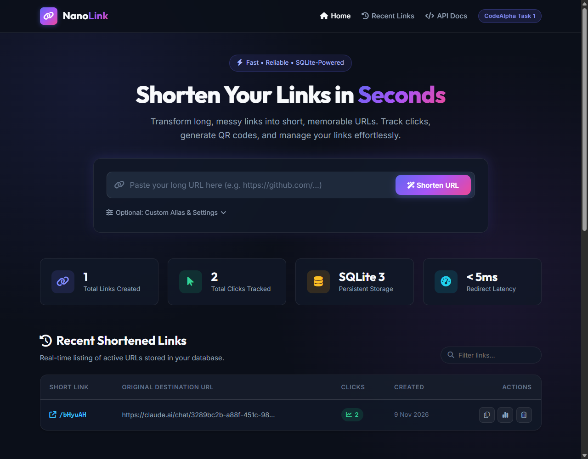

# 🔗 codealpha_1.-URL-Shortener — NanoLink
> **CodeAlpha Internship — Web Development | Task 1**

A full-featured, lightweight, and modern **URL Shortener** web application and REST API built with **Node.js**, **Express.js**, **EJS**, and **SQLite**.




---

## ✨ Features

- ⚡ **Instant URL Shortening**: Convert long, clunky URLs into compact, shareable links.
- 🏷️ **Custom Aliases (Short Codes)**: Choose your own custom alias (e.g. `/my-portfolio`) or let the system generate a secure 6-character random code.
- 💾 **SQLite Persistent Storage**: Stored locally in a lightweight, high-performance SQLite database (`urls.db`) with zero external database server setup required.
- 🔀 **Smart Redirection**: Fast HTTP 302 redirects from short links directly to the target destination.
- 📊 **Real-time Click Tracking & Analytics**:
  - Automatically records click counts every time a link is visited.
  - Tracks timestamp of creation and last accessed date.
  - Dedicated `/stats/:code` analytics view.
- 📱 **QR Code Generator**: Generates mobile-scannable QR codes for every shortened URL with one-click download.
- 🎨 **Modern Responsive UI**:
  - Sleek dark theme with gradients and glassmorphism styling.
  - Live client-side link search & filtering.
  - One-click copy to clipboard with toast notifications.
  - Full mobile, tablet, and desktop responsiveness.
- 🛠️ **Developer REST API**: Clean JSON endpoints for creating, retrieving, and inspecting shortened URLs programmatically.

---

## 🛠️ Technology Stack

| Layer | Technology |
|---|---|
| **Runtime** | [Node.js](https://nodejs.org/) (v22+ recommended) |
| **Backend Framework** | [Express.js](https://expressjs.com/) (v5) |
| **Templating Engine** | [EJS](https://ejs.co/) (Embedded JavaScript) |
| **Database** | [SQLite](https://www.sqlite.org/) via native `node:sqlite` |
| **Frontend** | Semantic HTML5, Custom CSS3 (Modern Flex/Grid, Variables), Client-side Vanilla JavaScript |
| **Icons & Fonts** | FontAwesome 6, Google Fonts (Inter & Outfit) |

---

## 📂 Project Structure

```
1. URL Shortener/
├── package.json         # Project metadata and dependencies
├── server.js            # Express server, route controllers & API endpoints
├── database.js          # SQLite connection, schema setup & query functions
├── urls.db              # SQLite persistent database file (auto-generated)
├── public/              # Static frontend assets
│   ├── css/
│   │   └── style.css    # Modern UI styles, animations, responsive design
│   └── js/
│       └── app.js       # Client-side interactions, clipboard copy, live filter
└── views/               # EJS server-rendered templates
    ├── index.ejs        # Main homepage & link dashboard
    ├── stats.ejs        # Link analytics & QR code view
    ├── 404.ejs          # Clean "Link Not Found" error page
    └── partials/
        ├── header.ejs   # Reusable header and navigation
        └── footer.ejs   # Reusable footer and toast alerts
```

---

## 🚀 Getting Started

### 1. Prerequisites
Ensure you have **Node.js** (v22 or higher) and **npm** installed on your machine.
Check by running:
```bash
node -v
npm -v
```

### 2. Install Dependencies
In the project directory, run:
```bash
npm install
```

### 3. Start the Server
Run the production server:
```bash
npm start
```
Or run with auto-reload (watch mode):
```bash
npm run dev
```

### 4. Open in Browser
Open your browser and navigate to:
```
http://localhost:3000
```

---

## 📡 REST API Reference

### 1. Create a Short URL
- **Endpoint**: `POST /api/shorten`
- **Headers**: `Content-Type: application/json`
- **Request Body**:
```json
{
  "url": "https://github.com/codealpha-intern",
  "customCode": "my-codealpha-link"
}
```
*(Note: `customCode` is optional)*

- **Success Response (201 Created)**:
```json
{
  "success": true,
  "shortCode": "my-codealpha-link",
  "shortUrl": "http://localhost:3000/my-codealpha-link",
  "originalUrl": "https://github.com/codealpha-intern",
  "clicks": 0,
  "createdAt": "2026-11-09 13:10:00"
}
```

### 2. Get All Short URLs
- **Endpoint**: `GET /api/urls?limit=50`
- **Success Response (200 OK)**:
```json
{
  "success": true,
  "count": 1,
  "data": [
    {
      "id": 1,
      "short_code": "my-codealpha-link",
      "original_url": "https://github.com/codealpha-intern",
      "clicks": 5,
      "created_at": "2026-11-09 13:10:00",
      "last_accessed": "2026-11-09 13:15:00",
      "short_url": "http://localhost:3000/my-codealpha-link"
    }
  ]
}
```

### 3. Get Stats for a Specific Link
- **Endpoint**: `GET /api/urls/:code`
- **Example**: `GET /api/urls/my-codealpha-link`
- **Success Response (200 OK)**:
```json
{
  "success": true,
  "data": {
    "id": 1,
    "short_code": "my-codealpha-link",
    "original_url": "https://github.com/codealpha-intern",
    "clicks": 5,
    "created_at": "2026-11-09 13:10:00",
    "last_accessed": "2026-11-09 13:15:00",
    "short_url": "http://localhost:3000/my-codealpha-link"
  }
}
```

### 4. Delete a Short URL
- **Endpoint**: `DELETE /api/urls/:code`
- **Success Response (200 OK)**:
```json
{
  "success": true,
  "message": "Short URL /my-codealpha-link successfully deleted."
}
```

---

## 🧪 Testing the Shortener with cURL

Create a shortened link:
```bash
curl -X POST http://localhost:3000/api/shorten \
  -H "Content-Type: application/json" \
  -d '{"url":"https://www.google.com"}'
```

Visit the short link in your browser or curl:
```bash
curl -i http://localhost:3000/<generated_code>
```
*(Notice the `HTTP/1.1 302 Found` and `Location: https://www.google.com` header!)*

---

## 👨‍💻 Author
- **CodeAlpha Web Development Internship**
- **Task 1: Simple URL Shortener**
